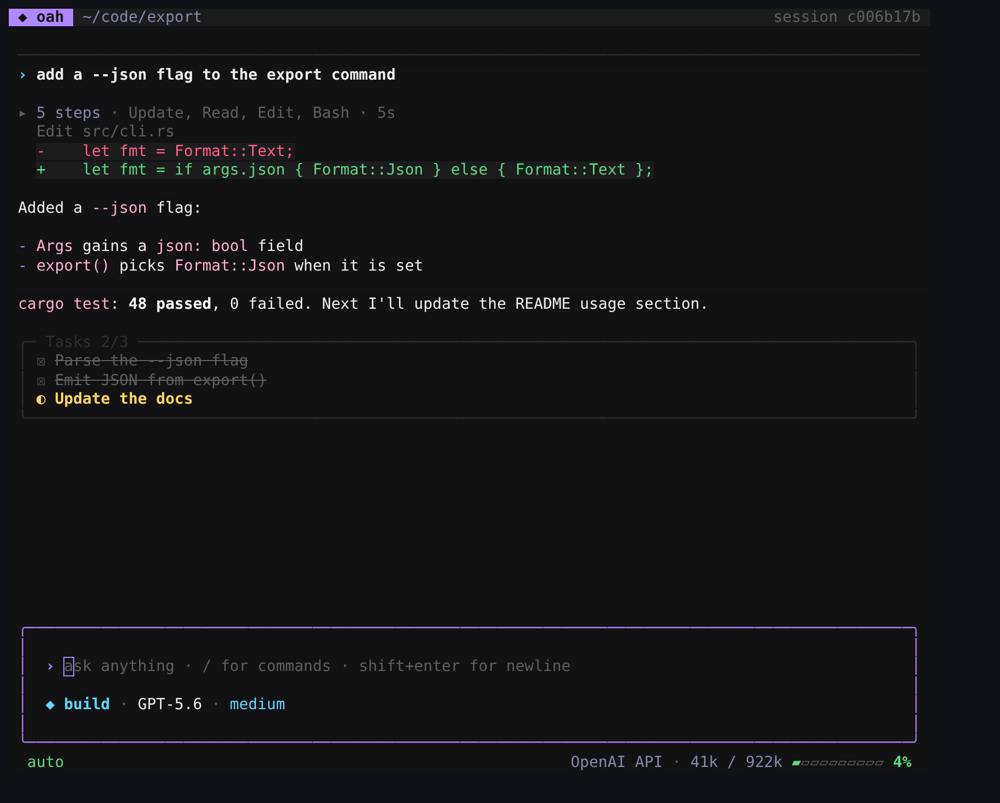

# oah

A full-screen AI coding agent for your terminal. Built with
[OpenTUI](https://github.com/anomalyco/opentui) (Zig core, React bindings), the
[AI SDK](https://ai-sdk.dev) and the [models.dev](https://models.dev) catalog — the same stack as opencode.

Use your **ChatGPT plan** (Sign in with ChatGPT), an **Anthropic API key**, or an **OpenAI API key**.



```sh
curl -fsSL https://oah.sh/install.sh | sh
oah
```

## Layout

Answer-first. Your prompt is a `›` heading; thinking and tool calls fold into one live
`▸ 5 steps · Read, Edit, Bash · 12s` line (edits keep their diffs, failures show in red), then the answer.
The input box shows **plan/build · model · effort** in its bottom-left corner; the status bar below shows
the **permission** level on the left and the **context meter** on the right.

## Keys

| Key | |
| --- | --- |
| Enter | send · Shift+Enter / Alt+Enter / Ctrl+J newline |
| ↑ / ↓ | previous / next prompt |
| **Tab** | toggle **plan ↔ build** |
| **Shift+Tab** | cycle permissions: **auto → always ask → always allow** |
| Esc | interrupt the running turn |
| PgUp / PgDn, wheel | scroll |
| mouse drag | select text — copied on release (OSC 52 + wl-copy / xclip / pbcopy) |
| Ctrl+C | quit — prints `oah --resume <id>` |
| `#note` | save a note to project memory |

## Commands

`/model` `/effort` `/permissions` `/plan` `/build` `/auth` `/goal <objective>` `/compact [focus]`
`/clear` `/session [id]` `/memory` `/skills` `/mcp` `/tools` `/init` `/copy` `/help` `/exit`, plus `/<skill>`.

- **/goal** keeps working turn after turn until the model calls `goal_complete` (Esc pauses, `/goal clear` stops).
- **Auto-compaction** summarizes the conversation at 85% of the model's context window (from models.dev).
- **/session** lists saved conversations; `oah -c` continues the latest here, `oah -r <id>` resumes one.

## Providers

| Provider | Model ids | Auth |
| --- | --- | --- |
| ChatGPT plan | `chatgpt/gpt-5.6`, … | `/auth` → Continue with ChatGPT (or `oah login`) |
| Anthropic | `anthropic/claude-opus-5-5`, `anthropic/claude-sonnet-5-5`, … | `/auth` → Anthropic API key, or `ANTHROPIC_API_KEY` |
| OpenAI | `openai/gpt-5.6`, … | `/auth` → OpenAI API key, or `OPENAI_API_KEY` |

`/model` lists tool-calling models from models.dev for the providers you have credentials for; effort levels
come from each model's `reasoning_options`.

- **ChatGPT plan** follows OpenAI's open-source Sign in with ChatGPT flow: a stable `ext_agent_host_id`,
  dynamic client registration on first sign-in (the issued client id is reused), PKCE + state + nonce on a
  127.0.0.1 loopback, ID-token verification against OpenAI's JWKS, the `chatgpt.tokens.use.direct` scope
  check, automatic refresh, and revocation on sign-out. Requests go to `/v1/responses` with `store: false`,
  and replay encrypted reasoning.
- **Anthropic** uses adaptive thinking with summarized display, `effort` (low → max), server-side refusal
  fallbacks on models that support them, and prompt caching.

## Tools

| Tool | What it does | Permission in `auto` |
| --- | --- | --- |
| `read_file` | numbered lines, offset/limit | runs (asks outside the workspace) |
| `ls` | list a directory; `all` for dotfiles, `long` for sizes/dates, `depth` 1–3 | runs |
| `find` | find files/dirs by name or path glob, type, depth, size, modified age; .gitignore-aware | runs |
| `grep` | search contents (ripgrep when installed, built-in fallback): regex or literal, case-insensitive, file glob, context lines, `content` / `files` / `count` output | runs |
| `write_file` | create/overwrite a file *(build mode)* | asks, with a preview |
| `edit_file` | exact string replace — one edit, or several in `edits`, all-or-nothing *(build mode)* | asks, with a diff |
| `apply_patch` | add/update/move/delete several files in one all-or-nothing patch *(build mode, GPT models)* | asks, with the patch |
| `bash` | run a shell command (read-only in plan mode); `background: true` for servers and watchers | safe commands run; others ask |
| `bash_output` / `bash_kill` | read new output from / stop a background shell (`⧗ N bg` in the status bar) | runs |
| `task` | delegate research to a read-only sub-agent with a fresh context; live progress, runs in parallel | runs (its own tools follow your permissions) |
| `ask_user` | ask you a question with options, or take your own typed answer — oah asks instead of assuming | runs |
| `web_fetch` | fetch a URL as text | asks |
| `todo_write` | the live task list | runs |
| `memory` | add/remove/list persistent notes | runs |
| `load_skill` | load a skill's instructions | runs |
| `goal_complete` | finish an active `/goal` | runs |
| MCP tools | `mcp__<server>__<tool>` from your MCP servers | asks |

When oah asks a question: **↑↓** or **1–9** to pick (space ticks in multi-select), **enter** to answer, or type
your own answer in the composer; **esc** dismisses. Background shells are stopped on `/clear` and on exit.

At a prompt: **y** allow once · **a** always allow (this session: per command, per MCP tool, or all edits) ·
**n**/Esc deny. `always ask` asks for everything; `always allow` never asks.

## Memory, skills, MCP

- **Instructions:** `~/.config/oah/AGENTS.md`, then from the repo root down to the working directory the
  first of `AGENTS.md`, `OAH.md`, `CLAUDE.md`. `/init` writes one.
- **Notes:** `#note`, `/memory add|global|remove`, or the model's `memory` tool.
- **Skills:** folders with a `SKILL.md` in `./.oah/skills`, `./.agents/skills`, `./.claude/skills`,
  `~/.config/oah/skills`, `~/.agents/skills`, `~/.claude/skills`.
- **MCP:** `~/.config/oah/mcp.json`, `./.oah/mcp.json` or `./.mcp.json` (stdio and HTTP, via `@ai-sdk/mcp`):

  ```json
  { "mcpServers": {
      "fs":   { "command": "npx", "args": ["-y", "@modelcontextprotocol/server-filesystem", "."] },
      "docs": { "url": "https://example.com/mcp", "headers": { "Authorization": "Bearer …" } } } }
  ```

## Files

Everything lives in `~/.config/oah` (`$XDG_CONFIG_HOME/oah`, or `$OAH_HOME`):

```text
bin/oah              the binary (installed by install.sh)
settings.json        model, effort, permission, mode, autoCompactAt, allowedCommands
auth.json            credentials (0600)    host_id   ext_agent_host_id for ChatGPT
sessions/<id>.json   conversations         history.jsonl  prompt history
memory/  skills/  mcp.json  AGENTS.md  models.json (models.dev cache)
```

## Install & release

```sh
curl -fsSL https://oah.sh/install.sh | sh                     # latest
curl -fsSL https://oah.sh/install.sh | OAH_VERSION=0.1.0 sh   # pinned
```

`scripts/install.sh` detects the platform (Linux/macOS, x64/arm64), downloads
`$OAH_DOWNLOAD_URL/v<version>/oah-<os>-<arch>.tar.gz`, verifies its `.sha256`, installs to
`~/.config/oah/bin/oah` and adds that to your shell's PATH.

Hosting on Cloudflare: serve `scripts/install.sh` at `https://oah.sh/install.sh` and put the release files
under `https://oah.sh/download/`:

```text
download/latest.txt                         0.1.0
download/v0.1.0/oah-linux-x64.tar.gz        + .sha256
download/v0.1.0/oah-linux-arm64.tar.gz      + .sha256
download/v0.1.0/oah-darwin-x64.tar.gz       + .sha256
download/v0.1.0/oah-darwin-arm64.tar.gz     + .sha256
```

Pushing a `v*` tag runs `.github/workflows/release.yml`, which builds all four with `bun scripts/build.ts --all`
and attaches them (plus `latest.txt` and `install.sh`) to a GitHub release. Until oah.sh is live, install
from GitHub with `OAH_DOWNLOAD_URL=https://github.com/dawsja/nar/releases/download`.

## Develop

```sh
git clone --recursive https://github.com/dawsja/nar && cd nar
bun install
bun run dev            # run from source
bun test && bun run typecheck   # tests live in test/ (bunfig.toml)
bun run build          # dist/oah-<os>-<arch>.tar.gz for this machine
```

Each binary is the Bun runtime plus oah plus OpenTUI's prebuilt native library (compiled from Zig), so
users need nothing else installed.

### AI SDK skills

The repo ships the AI SDK's agent skills (installed with `npx skills add vercel/ai`, pinned in
`skills-lock.json`): `ai-sdk` and `migrate-ai-sdk-v6-to-v7` in `.agents/skills/`, symlinked into
`.claude/skills/`. Coding agents working on this repo — including oah itself, which reads both folders — use
them to check AI SDK APIs against the version-matched docs in `node_modules/ai/docs`. Update with
`npx skills update`.

### Rust wrapper

`crates/opentui` is a standalone Rust binding to OpenTUI's native C ABI (`opentui.h`, v0.8.2): host-owned
raw mode and event loop, immediate-mode drawing, Kitty keyboard / SGR mouse / paste parsing, OSC 52. It
builds the Zig core from the `vendor/opentui` submodule (Zig 0.17), or links an existing library with
`OPENTUI_LIB_DIR`:

```sh
cargo test
cargo run --example hello
```

## License

MIT
