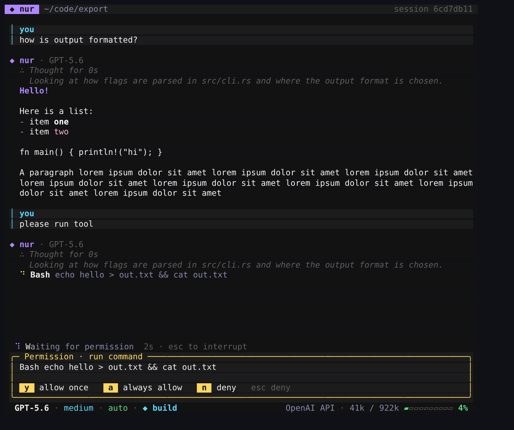
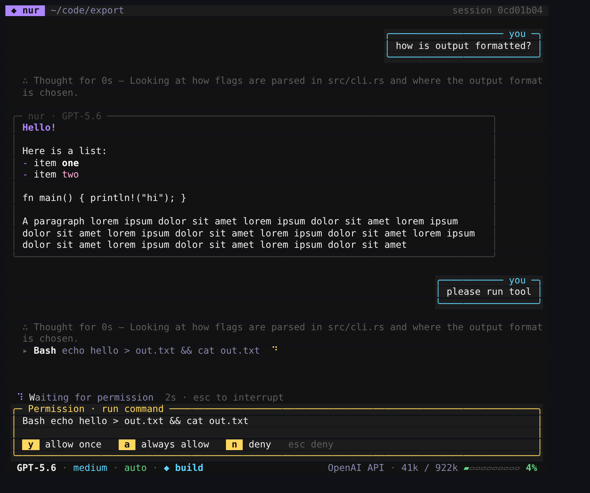
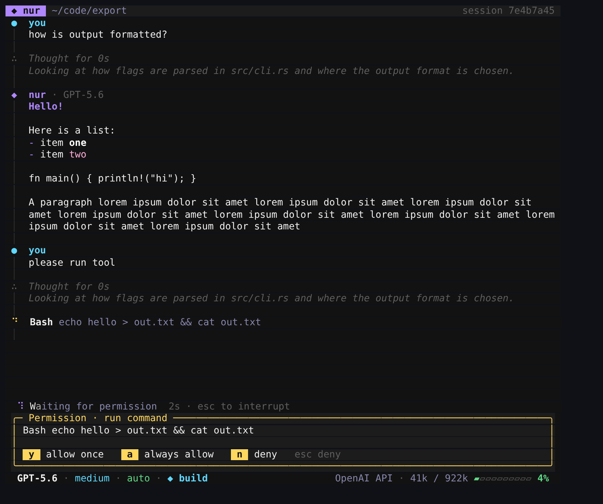

# nur

A full-screen AI coding agent for your terminal. Built with
[OpenTUI](https://github.com/anomalyco/opentui) (Zig core, React bindings), the
[AI SDK](https://ai-sdk.dev) and the [models.dev](https://models.dev) catalog — the same stack as opencode.

Use your **ChatGPT plan** (Sign in with ChatGPT), an **Anthropic API key**, or an **OpenAI API key**.


```sh
curl -fsSL https://nur.sh/install.sh | sh
nur
```

## Designs

Three transcript looks. Switch any time with `/design` or start with `nur -d b`.

| A · Panels | B · Bubbles | C · Timeline |
| --- | --- | --- |
|  |  |  |
| you: tinted panel with a cyan bar · nur: `◆ nur · model` column | you: bubble on the right · nur: bubble on the left | one rail, a node per event: `●` you, `◆` nur, `○` tools, `∴` thinking |

Everywhere: a spinner + shimmering "Thinking" line while the model works, `∴ Thought for 4s` summaries,
tool calls as `✓ Bash cargo test · 2s` with a `⎿ exit 0 · 3 lines` result and inline diffs, a live task
list, and a status bar with **model · effort · permission · plan/build** on the left and the **context
meter** on the right.

## Keys

| Key | |
| --- | --- |
| Enter | send · Shift+Enter / Alt+Enter / Ctrl+J newline |
| ↑ / ↓ | previous / next prompt |
| **Tab** | toggle **plan ↔ build** |
| **Shift+Tab** | cycle permissions: **auto → always ask → always allow** |
| Esc | interrupt the running turn |
| PgUp / PgDn, wheel | scroll |
| mouse drag | select text — copied on release (OSC 52 + wl-copy / xclip / pbcopy) |
| Ctrl+C | quit — prints `nur --resume <id>` |
| `#note` | save a note to project memory |

## Commands

`/model` `/effort` `/permissions` `/plan` `/build` `/design` `/auth` `/goal <objective>` `/compact [focus]`
`/clear` `/session [id]` `/memory` `/skills` `/mcp` `/tools` `/init` `/copy` `/help` `/exit`, plus `/<skill>`.

- **/goal** keeps working turn after turn until the model calls `goal_complete` (Esc pauses, `/goal clear` stops).
- **Auto-compaction** summarizes the conversation at 85% of the model's context window (from models.dev).
- **/session** lists saved conversations; `nur -c` continues the latest here, `nur -r <id>` resumes one.

## Providers

| Provider | Model ids | Auth |
| --- | --- | --- |
| ChatGPT plan | `chatgpt/gpt-5.6`, … | `/auth` → Continue with ChatGPT (or `nur login`) |
| Anthropic | `anthropic/claude-opus-5-5`, `anthropic/claude-sonnet-5-5`, … | `/auth` → Anthropic API key, or `ANTHROPIC_API_KEY` |
| OpenAI | `openai/gpt-5.6`, … | `/auth` → OpenAI API key, or `OPENAI_API_KEY` |

`/model` lists tool-calling models from models.dev for the providers you have credentials for; effort levels
come from each model's `reasoning_options`.

- **ChatGPT plan** follows OpenAI's open-source Sign in with ChatGPT flow: a stable `ext_agent_host_id`,
  dynamic client registration on first sign-in (the issued client id is reused), PKCE + state + nonce on a
  127.0.0.1 loopback, ID-token verification against OpenAI's JWKS, the `chatgpt.tokens.use.direct` scope
  check, automatic refresh, and revocation on sign-out. Requests go to `/v1/responses` with `store: false`,
  and replay encrypted reasoning.
- **Anthropic** uses adaptive thinking with summarized display, `effort` (low → max), server-side refusal
  fallbacks on models that support them, and prompt caching.

## Tools

| Tool | What it does | Permission in `auto` |
| --- | --- | --- |
| `read_file` | numbered lines, offset/limit | runs (asks outside the workspace) |
| `list_dir` | directory listing | runs |
| `glob` | find files by pattern, .gitignore-aware | runs |
| `grep` | regex search across files | runs |
| `write_file` | create/overwrite a file *(build mode)* | asks, with a preview |
| `edit_file` | exact string replace *(build mode)* | asks, with a diff |
| `bash` | run a shell command (read-only in plan mode) | safe commands run; others ask |
| `web_fetch` | fetch a URL as text | asks |
| `todo_write` | the live task list | runs |
| `memory` | add/remove/list persistent notes | runs |
| `load_skill` | load a skill's instructions | runs |
| `goal_complete` | finish an active `/goal` | runs |
| MCP tools | `mcp__<server>__<tool>` from your MCP servers | asks |

At a prompt: **y** allow once · **a** always allow (this session: per command, per MCP tool, or all edits) ·
**n**/Esc deny. `always ask` asks for everything; `always allow` never asks.

## Memory, skills, MCP

- **Instructions:** `~/.config/nur/AGENTS.md`, then from the repo root down to the working directory the
  first of `AGENTS.md`, `NUR.md`, `CLAUDE.md`. `/init` writes one.
- **Notes:** `#note`, `/memory add|global|remove`, or the model's `memory` tool.
- **Skills:** folders with a `SKILL.md` in `./.nur/skills`, `./.agents/skills`, `./.claude/skills`,
  `~/.config/nur/skills`, `~/.agents/skills`, `~/.claude/skills`.
- **MCP:** `~/.config/nur/mcp.json`, `./.nur/mcp.json` or `./.mcp.json` (stdio and HTTP, via `@ai-sdk/mcp`):

  ```json
  { "mcpServers": {
      "fs":   { "command": "npx", "args": ["-y", "@modelcontextprotocol/server-filesystem", "."] },
      "docs": { "url": "https://example.com/mcp", "headers": { "Authorization": "Bearer …" } } } }
  ```

## Files

Everything lives in `~/.config/nur` (`$XDG_CONFIG_HOME/nur`, or `$NUR_HOME`):

```text
bin/nur              the binary (installed by install.sh)
settings.json        model, effort, permission, mode, design, autoCompactAt, allowedCommands
auth.json            credentials (0600)    host_id   ext_agent_host_id for ChatGPT
sessions/<id>.json   conversations         history.jsonl  prompt history
memory/  skills/  mcp.json  AGENTS.md  models.json (models.dev cache)
```

## Install & release

```sh
curl -fsSL https://nur.sh/install.sh | sh                     # latest
curl -fsSL https://nur.sh/install.sh | NUR_VERSION=0.1.0 sh   # pinned
```

`scripts/install.sh` detects the platform (Linux/macOS, x64/arm64), downloads
`$NUR_DOWNLOAD_URL/v<version>/nur-<os>-<arch>.tar.gz`, verifies its `.sha256`, installs to
`~/.config/nur/bin/nur` and adds that to your shell's PATH.

Hosting on Cloudflare: serve `scripts/install.sh` at `https://nur.sh/install.sh` and put the release files
under `https://nur.sh/download/`:

```text
download/latest.txt                         0.1.0
download/v0.1.0/nur-linux-x64.tar.gz        + .sha256
download/v0.1.0/nur-linux-arm64.tar.gz      + .sha256
download/v0.1.0/nur-darwin-x64.tar.gz       + .sha256
download/v0.1.0/nur-darwin-arm64.tar.gz     + .sha256
```

Pushing a `v*` tag runs `.github/workflows/release.yml`, which builds all four with `bun scripts/build.ts --all`
and attaches them (plus `latest.txt` and `install.sh`) to a GitHub release. Until nur.sh is live, install
from GitHub with `NUR_DOWNLOAD_URL=https://github.com/dawsja/nar/releases/download`.

## Develop

```sh
bun install
bun run dev            # run from source
bun test && bun run typecheck
bun run build          # dist/nur-<os>-<arch>.tar.gz for this machine
```

Each binary is the Bun runtime plus nur plus OpenTUI's prebuilt native library (compiled from Zig), so
users need nothing else installed.

## License

MIT
